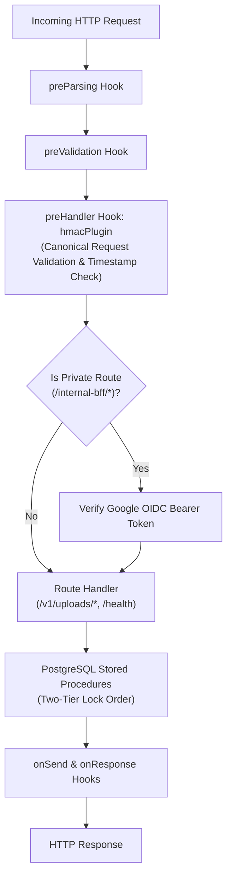

# 01 — `shadify-api` Architecture & Design

**Stack:** Fastify 5.2.1, Node.js 24 (`>=24.0.0 <25`), TypeScript 5.8+, Prisma 6.4.1  
**Runtime Environment:** Google Cloud Run (Regional: `asia-south1`)  
**Database:** Cloud SQL PostgreSQL 16 Enterprise (via Direct VPC Egress)

---

## 1. Architectural Role & Responsibilities

`shadify-api` serves as the centralized backend service and background worker pool for the platform:
1. **Public Ingress Gateway (`/v1/*`)**: Validates Cloudflare edge HMAC signatures, preventing origin spoofing and direct load balancer bypass.
2. **Private Administrative BFF Gateway (`/internal-bff/*`)**: Accessible only within the private VPC via Internal Application Load Balancer (ILB), requiring Google Cloud OIDC Service Account bearer tokens.
3. **Storage Pipeline Coordinator**: Issues presigned Cloudflare R2 direct-to-storage URLs for single-part and multipart uploads, completely bypassing compute egress.
4. **Asynchronous Outbox Worker**: Continuously polls the transactional outbox table, resizes photos into WebP previews and thumbnails using Worker Threads and Sharp, and publishes winning generation keys.

---

## 2. Fastify Plugin Lifecycle

---

## 3. Deployment Configuration (Google Cloud Run)

- **Container Image**: Built with Node.js 24-slim base image, multi-stage compilation (`tsc`), running non-root `node` user.
- **Ingress Setting**: `--ingress=internal-and-cloud-load-balancing` (blocks raw internet access, routing strictly through GCP ALB Serverless NEGs).
- **VPC Connector**: Direct VPC Egress configured to route database traffic directly to private Cloud SQL IP (`10.x.x.x`).
- **Concurrency**: Fastify API container: concurrency = 80; Worker runtime container: concurrency = 5 (CPU-bound image transform limits).
- **Shutdown Grace Period**: 10,000 ms (`SIGTERM` handling).
