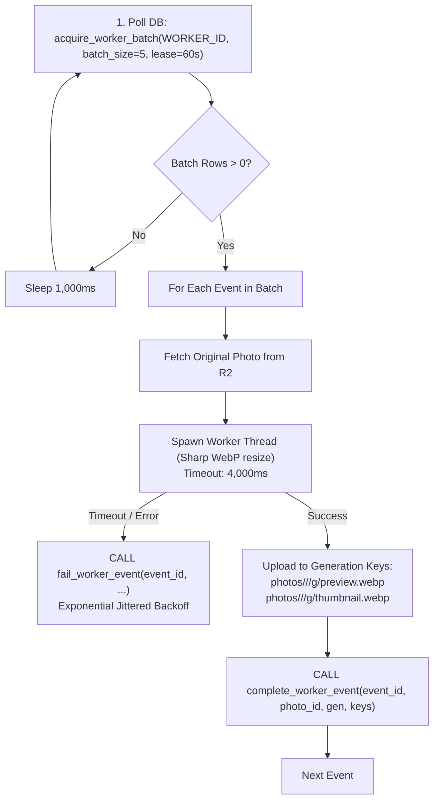

# 03 — Asynchronous Worker Runtime & Image Transformation Engine

**Authority:** ADR-006, ADR-012 & Master Blueprint v1.0.18  
**Key Dependencies:** `sharp@0.33.5`, `node:worker_threads`, `@aws-sdk/client-s3`

---

## 1. Outbox Worker Loop Architecture

The worker runtime executes a continuous polling loop over `outbox_events`:



---

## 2. Sharp Image Processing via Worker Threads

### Why Worker Threads?
Sharp runs native C++ libvips routines. When processing corrupt or massive 50MB RAW/JPEG images, libvips cannot be interrupted by JavaScript `AbortSignal`. If a synchronous Sharp transform runs on the main Node.js thread, it blocks the event loop and delays HTTP keep-alive probes.

### Bounded Cancellation Contract:
- Transforms execute inside `src/worker/transform-worker.ts` via `node:worker_threads`.
- The parent runtime sets a hard **4,000 ms timeout**.
- If execution exceeds 4.0s, the parent calls `worker.terminate()`.
- If the thread does not terminate within 1.0s, the process issues a forced thread kill, preventing thread leaks.

---

## 3. Cloud Run 10-Second Graceful Shutdown Budget

When Google Cloud Run scales down or restarts an instance, it sends a `SIGTERM` signal and allows **10,000 ms** before sending `SIGKILL`.

```text
Time from SIGTERM:
+-----------------------------------------------------------------------------------------+
|  0ms - 500ms    | Stop Polling Loop & In-flight HTTP Listeners                          |
|  500ms - 4,500ms| Await Active Sharp Worker Threads (capped at 4s timeout)              |
| 4,500ms - 6,500ms| Call release_worker_leases() to unlock active events back to PENDING   |
| 6,500ms - 7,500ms| Drain and Close PostgreSQL Connection Pool (dbPool.end())             |
| 7,500ms - 8,000ms| Process Exits Cleanly (exit code 0)                                   |
+-----------------------------------------------------------------------------------------+
```

---

## 4. Generation-Scoped Derivative Overwrite Safety

All derivative keys in Cloudflare R2 are scoped to the entity's `generation_token`:
- `photos/<wedding_id>/<photo_id>/g<generation>/preview.webp`
- `photos/<wedding_id>/<photo_id>/g<generation>/thumbnail.webp`

**Safety Invariant:** If Worker 1 holds lease on generation 1, stalls during upload, and the Watchdog Reaper reclaims the event and awards generation 2 to Worker 2:
- Worker 2 writes to `g2/preview.webp` and successfully commits.
- When Worker 1 recovers, its late write goes to `g1/preview.webp`.
- Worker 1's DB commit fails because `photos.processing_generation` is now 2.
- The newer generation 2 output is **never corrupted or overwritten**.
